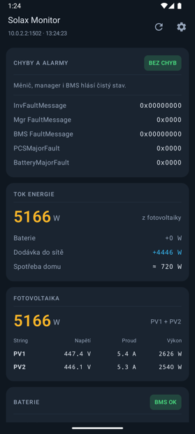
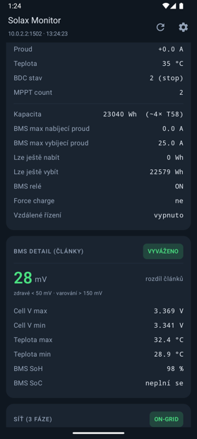
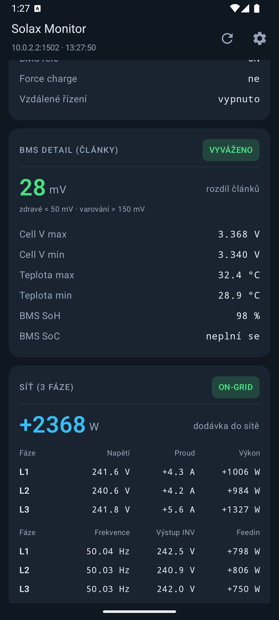
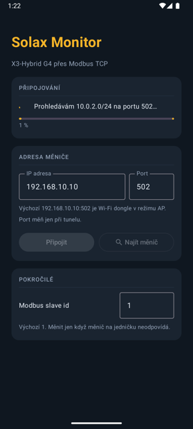

# Solax Monitor

Android aplikace pro čtení stavu fotovoltaického měniče **Solax X3-Hybrid G4** přes Modbus TCP,
plus referenční Python skripty. Čte přímo z měniče po lokální síti — žádný cloud, žádné přihlašování.

> **English:** Android app + Python scripts for reading a Solax X3-Hybrid G4 inverter over
> Modbus TCP on the local network. Read-only, no cloud. UI and docs are in Czech.

<p>
  
  
  
  
</p>

Vizuální průvodce aplikací: [`docs/navod.html`](docs/navod.html) — stáhni a otevři v prohlížeči.

## Aplikace pouze čte

Do měniče se **nikdy nic nezapisuje**. Používají se výhradně funkce `0x03` (read holding registers)
a `0x04` (read input registers). Zápis do holding registrů mění chování živého bateriového systému
a ukládá se do flash paměti měniče — do téhle aplikace záměrně nepatří.

## Co umí

- **Automatické připojení** — zkusí výchozí `192.168.10.10` (Wi-Fi dongle v režimu AP),
  pak naposledy použité adresy, a když nic neodpoví, oskenuje podsíť `/24` na portu 502.
- **Dashboard** — chyby a alarmy, tok energie, PV1/PV2 zvlášť, baterie, BMS detail,
  síť po jednotlivých fázích, elektroměr, denní i celkové energie, nastavení, časová okna.
- **Nabíječky X3-HAC-22P** — záložka *Nabíječky*: stav, výkon po fázích, relace, nastavení a paralelní
  provoz primary/secondary. Čte přímo z nabíječek (port 502, výchozí `192.168.0.137` a `.142`, adresy
  se mění v Nastavení). Protokol chce ≥ 1 s mezi dotazy, takže jedno čtení trvá ~3 s. Jen čtení.
- **Dekódování chyb** podle protokolu — tabulky 2-3 (měnič X3), 2-5 (manager) a 2-6 (BMS).
- **Zdraví článků** — rozdíl napětí článků s barevným prahem: zdravé < 50 mV, varování > 150 mV.
- **Obnova** 2/5/10/30 s nebo vlastní 1–30 s.

Aplikace váže socket na Wi-Fi síť přes `ConnectivityManager`. Bez toho by Android
provoz na dongle bez internetu přesměroval na mobilní data a spojení by selhalo.

## Instalace

Stáhni APK z [Releases](../../releases) a nainstaluj v telefonu (je potřeba povolit instalaci
z neznámých zdrojů). Minimální verze Androidu je 8.0 (API 26).

Na domácí síti nech port `502` a zadej IP měniče, nebo použij tlačítko **Najít měnič**.

## Sestavení ze zdrojáků

```bash
cd SolaxMonitor
./gradlew assembleDebug
```

Release build vyžaduje vlastní podpisový klíč. Zkopíruj `SolaxMonitor/keystore.properties.vzor`
na `keystore.properties` a vyplň cestu ke klíči, heslo a alias. Bez tohoto souboru se projekt
postaví taky, jen release vyjde nepodepsaný.

## Python skripty

`read_solax.py` je referenční implementace — vypíše kompletní stav měniče do terminálu.
Aplikace z něj vychází a dekóduje registry úplně stejně.

```bash
pip3 install pymodbus      # pymodbus 3.x
python3 read_solax.py
```

IP adresa a slave id jsou nahoře ve skriptu. `scan_solax.py` najde měnič v síti,
když neznáš jeho adresu.

### Ověření, že appka počítá stejně

Skript umí uložit syrové registry a přehrát je později, takže se dá krmit obě implementace
identickými daty a výstupy porovnat:

```bash
SOLAX_RECORD=/tmp/raw.json python3 read_solax.py > /dev/null
SOLAX_REPLAY=/tmp/raw.json python3 read_solax.py > /tmp/py.txt
cd SolaxMonitor && ./gradlew :verify:run --args="/tmp/raw.json" -q > /tmp/kt.txt
diff /tmp/py.txt /tmp/kt.txt
```

Modul `verify` přilinkuje čistě JVM části aplikace (Modbus klient a dekódování) a vypíše je
ve stejném formátu jako Python. Umí i `--args="--live <host> <port>"` pro čtení přímo z měniče.

## Poznámky k protokolu

Vycházel jsem z dokumentu *Hybrid-X1X3-G4-ModbusTCPRTU*, tabulky chyb a režimů odpovídají V3.36 (use mode 4 Peak Shaving, 5 TOU; bity poruchy 21/22 Parallel a Hard Limit Fault). Pár míst, kde se
skutečné chování X3-Hybrid G4 (firmware ARM 1.57 / DSP 1.59) liší od dokumentace:

| Registr | Dokumentace | Skutečnost |
|---|---|---|
| input `0x66` | BusVolt, 0,1 V | není napětí DC busu — hodnota je záporná při nabíjení baterie a kolem +119 v klidu |
| input `0xBE` | BMS_UserSOC | vrací 0, platné SoC je v input `0x1C` |
| holding `0x1B` | SafetyCode, enum 0–39 | vrací hodnotu mimo rozsah |
| holding `0x200` | Subsystem_Num | nereportuje se, počet modulů odvozuji z kapacity BMS |
| input `0x54` | Lock state, 0/1 | vrací i nedokumentovanou hodnotu 2 |

Vendor PDF s register mapou v repozitáři **není** — je autorsky chráněné. Sežeň si ho u Solaxu.

## Licence

MIT, viz [LICENSE](LICENSE).

Projekt není nijak spojený se společností SolaX Power. Používáš ho na vlastní riziko.
